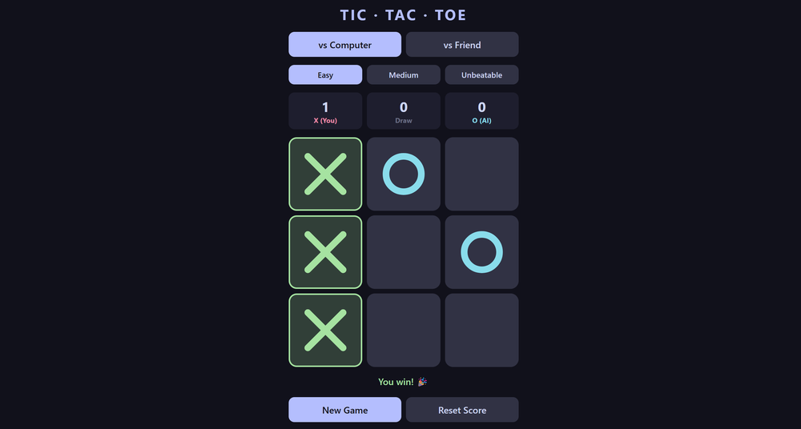
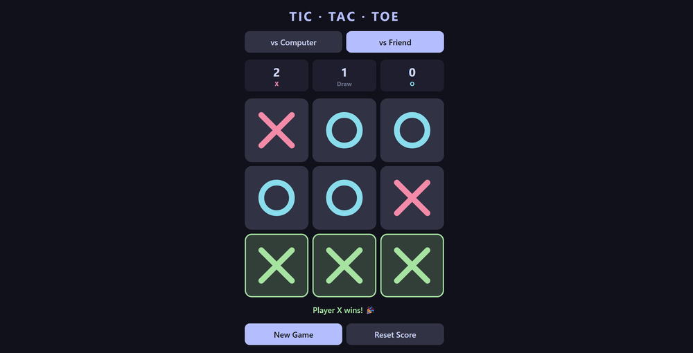
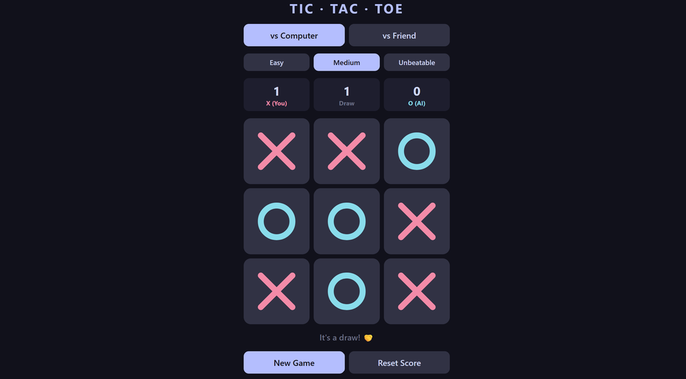

# Tic-Tac-Toe

Tic-Tac-Toe with a Minimax AI (3 levels on the web, unbeatable at the top), built twice: as a web page and as a Java desktop app.

- **Status:** finished
- **Keywords:** HTML, CSS, JavaScript, Java, Swing, Minimax, Alpha-Beta Pruning

## Highlights

- Built the same game in two versions: web (HTML, CSS, JavaScript) and Java Swing (desktop window).
- Added an AI with Minimax and Alpha-Beta Pruning. On "Unbeatable", the best a player can get is a draw.
- Added 3 levels in the web version: Easy (random moves), Medium (random half of the time) and Unbeatable.
- Added play vs Computer or vs Friend, a score board saved in the browser, a ghost preview of your move on hover and a green line on the winning cells.
- Made the web page work on phone and desktop.

## Screenshots



vs Computer on Easy: the winning column turns green and the score updates.



vs Friend: two players on one screen, and a win on the bottom row.



vs Computer on Medium: the game ends in a draw.

## Tech

- HTML, CSS, JavaScript: the web version, no framework and no install.
- Java Swing: the desktop version. Cells are painted by hand, so there is no default Swing look.
- Minimax with Alpha-Beta Pruning: the AI tries every possible game from the current board and skips branches that cannot change the result. The same logic is written in both languages.

## Run it

- Needs: any browser for the web version. JDK 8 or newer for the Java version.
- Tested on: Windows, Chrome (web version)

```bash
git clone https://github.com/sachinkrcodes/Tic-tac-toe.git
cd Tic-tac-toe
```

Web version: open `index.html` in a browser.

Java version:

```bash
cd java
javac TicTacToe.java
java TicTacToe
```

## Limits and next

- Not done: the Java version has only the Unbeatable AI. The 3 levels exist only in the web version.
- Not done: the Java version keeps the score only while the window is open.
- Not done: no automated tests.

## Author

Sachin Kumar | [GitHub](https://github.com/sachinkrcodes) | [LinkedIn](https://www.linkedin.com/in/sachinkrcodes) | Portfolio: [sachinkrcodes.vercel.app](https://sachinkrcodes.vercel.app) | sachinkrcodes@gmail.com

MIT License. See [LICENSE](LICENSE).
